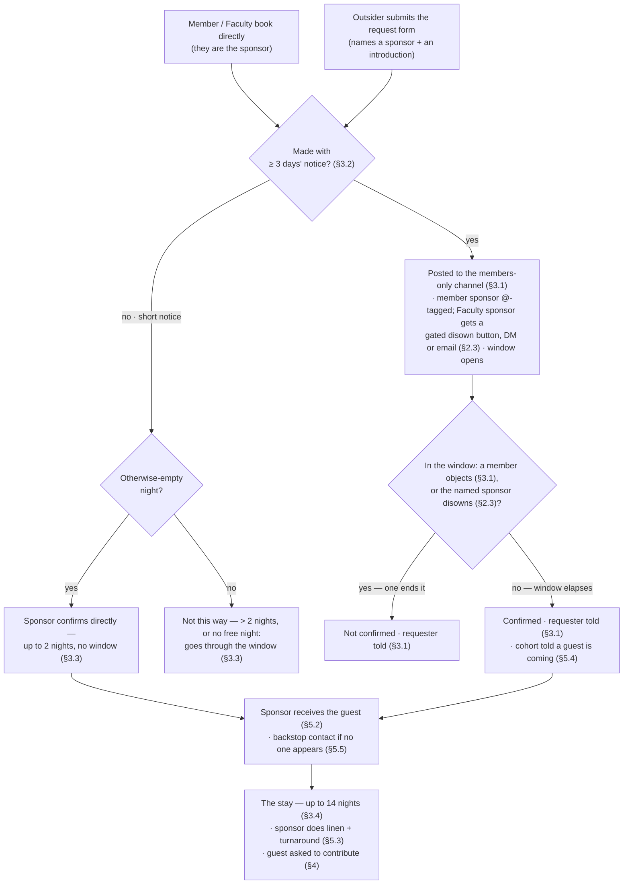

# Guest Room — approval flow

*Not operative. A spec artifact: the state machine the booking system runs to carry out the policy. The policy governs; this shows how a request moves from arrival to stay, with the clause each step discharges in parentheses. Use it to check that every policy requirement maps to a state — a requirement with no state here is a gap.*

**Notes.**
- A member's own booking is **not** a bypass: the room requires approval, so it enters the same window as a form request (§3.1).
- **Disown (§2.3) is separate from objection (§3.1).** Only members may object to any stay. A named sponsor may disown their *own*: a member via the Object button, a **Faculty** sponsor via a gated disown button only they can use (by DM, or email if not on the Discord). Faculty get no general objection.
- Steps that depend on the booking system being fully live (the post, the emails, the confirmation) are tracked in `implementation.md`.
